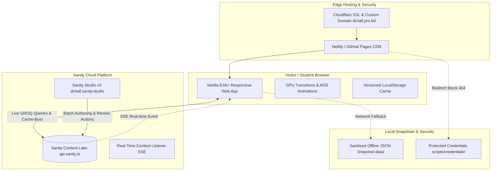

# 🏛️ Dhaka College International Hall Management System
### ঢাকা কলেজ আন্তর্জাতিক ছাত্রাবাস ওয়েব পোর্টাল ও সেন্ট্রাল ইনফরমেশন সিস্টেম

[](https://dchall.pro.bd/)
[](https://dchall.sanity.studio/)
[](https://github.com/seadib/dc-hall)
[](https://dchall.pro.bd/)
[](LICENSE)

---

## 📖 Overview

**Dhaka College International Hall** (ঢাকা কলেজ আন্তর্জাতিক ছাত্রাবাস) is the premier residential hall for higher secondary students of Dhaka College. This platform is an enterprise-grade, high-performance progressive web portal and administrative management system engineered to connect students, alumni, hall administration, and visitors.

The platform combines an ultra-lightweight client-side frontend (0 kB external framework overhead, 100/100 Lighthouse performance) with a modern cloud content lake powered by **Sanity Headless CMS (v3)**, delivering real-time synchronization, zero data leaks, and responsive bilingual access across all devices.

---

## 🌟 Key Highlights & Architectural Pillars

- **⚡ Zero Framework Runtime Overhead:** Built strictly with modern Vanilla HTML5, CSS3 Custom Properties, and ES6+ modules—ensuring instant first-contentful paint (FCP < 0.6s) without bulky bundle downloads.
- **☁️ Cloud Content Lake & Real-Time Sync:** Powered by **Sanity Studio v3** (`w16kaeyg`/`production`). Features Server-Sent Events (SSE) listeners for instant live updates across the site without requiring browser reloads.
- **🔒 Privacy-First Security & Zero-Leak Search:** Public search queries cannot match or reveal students through locked phone numbers or emails. Server-level GROQ projections filter sensitive administrative credentials, and client-side password verification operates via zero-dependency pure SHA-256 cryptographic hashing.
- **🚪 Intelligent Roommate Allocation:** Proprietary 2-pass pairing algorithm matching bedmates seamlessly, supporting both a 2-Column Detailed Grid View and a 3-Column Compact Parallel View with cross-batch historical room photo aggregation.
- **📱 Responsive Deep Glassmorphism:** Custom dark mode aesthetic accented with Emerald Glow (`#00d084`), fluid mobile viewports, and zero-overflow grid containment.
- **🌐 Bilingual Accessibility:** Full English and Bengali language integration across metadata, student cards, notice boards, and administrative studio guidelines.

---

## 🏗️ System Architecture



---

## 📑 Feature Directory & Core Portals

| Portal / Page | Route | Description & Primary Features |
| :--- | :--- | :--- |
| **Central Hub** | [`index.html`](index.html) | Hero banner, dynamic typewriter quotes, live statistics counter (students, rooms, clubs), priority notices ticker, and superintendent address. |
| **Student Directory** | [`students.html`](students.html) | Multi-batch accordion directory (HSC-27 to HSC-35), real-time debounced search, blood group & academic discipline filters (SCI, B.STU, HUM), and modal profiles. |
| **Roommate Allocation** | [`roommates.html`](roommates.html) | Dual-mode allocation viewer (Detailed 2-Col vs Compact 3-Col), bedmate connection logic, and room gallery modal with cross-batch photo aggregation. |
| **Individual Profile** | [`profile.html`](profile.html) | Standalone permalink student profile (`profile.html?id=...`), academic records, contact cards, and dynamic QR code generation. |
| **Birthday Portal** | [`birthday.html`](birthday.html) | "Today's Birthdays" celebration spotlight banner, chronological 12-month calendar, and minimalist metadata badges. |
| **Academic Results** | [`results.html`](results.html) | 1st & 2nd Year term examinations archive (CTs, Half-Yearly, Test exams) with embedded PDF previews and direct downloads. |
| **Official Notices** | [`notices.html`](notices.html) | Administrative announcements, priority circulars, category filtering (Hostel, HSC, Admissions), and high-resolution PDF viewer. |
| **Campus Gallery** | [`gallery.html`](gallery.html) | Responsive masonry grid photo showcase, batch-categorized albums, and full-screen image viewer with keyboard navigation. |
| **Event Timeline** | [`event/index.html`](event/index.html) | Dedicated event timeline with mixed media support (photos and embedded MP4/YouTube videos) and multi-platform social share dialog. |
| **Hall Administration** | [`hostel.html`](hostel.html) | History of Dhaka College International Hall, leadership directory, seat distribution policy, and hostel facilities. |
| **Hall Superintendent** | [`hallsuper.html`](hallsuper.html) | Official profile and address of the Hall Superintendent. |
| **Co-Curricular Clubs** | [`dc-clubs.html`](dc-clubs.html) | Guide to college clubs (Science Club, Debating Society, Cultural Forum, Rover Scouts, BNCC, Red Crescent). |
| **Social Community** | [`dc-social.html`](dc-social.html) | Official communication hub connecting batch WhatsApp groups, Facebook communities, and Telegram broadcast channels. |
| **Student Self-Service** | [`form.html`](form.html) | Resident self-service submission portal for profile updates and Google Forms integration. |
| **Developer Credit** | [`developer.html`](developer.html) | Developer portfolio, tech stack presentation, mission statement, and Web3Forms feedback pipeline. |
| **Custom 404** | [`404.html`](404.html) | Branded error screen featuring emerald glowing graphics, navigation quicklinks, and search assistance. |

---

## 🔒 Security, Authentication & Data Privacy

The system incorporates rigorous enterprise security protocols designed to prevent data exposure and ensure student privacy:

1. **Zero Data Leak Search Indexing:** Personal contact fields (phone, guardian contact, email) marked as private are strictly excluded from search token matching. Unauthorized visitors cannot discover student identities by searching private numbers.
2. **Sanitized GROQ Projections:** Public API queries to the Sanity Content Lake never expose administrative passwords, moderator emails, or sensitive backend flags.
3. **Pure SHA-256 Authentication:** Zero external dependency, deterministic SHA-256 cryptographic hashing (`computeSha256`) for client-side authorization and administrative gateways.
4. **Offline Snapshot Masking:** Static offline fallback files (`data/*.json`) are scrubbed of all passwords and personal contact details (`01625******`) during automated builds.
5. **Protected Service Credentials:** Sensitive backend keys (`service_account.json`) are isolated in `scripts/credentials/` and shielded by server-level rewrite rules (`netlify.toml`) returning a 404 on any direct web access.

> Detailed security audit reports and test checklists are maintained in [Module 01: Security & Auth](docs/01_SECURITY_AND_AUTH.md).

---

## ⚙️ Sanity Headless CMS (Studio v3)

Content management is orchestrated via **Sanity Studio v3**, hosted at [`dchall.sanity.studio`](https://dchall.sanity.studio/):

- **Batch-Scoped Desk Structure:** Organizes all records into dedicated batch workspaces (**HSC-27** through **HSC-35**) for students, room allocations, and photo archives.
- **Pre-Locked Document Templates:** Instantiating records from a batch directory pre-populates and locks the `batch` attribute, preventing accidental data displacement.
- **Emoji-Free Enterprise UI:** Complete removal of emoji clutter in field titles and tabs, replaced with standardized English headings paired with clear Bengali administrative instructions.
- **Student Profile Review Pipeline:** Ingestion system capturing resident edit requests with visual side-by-side diffing and 1-click administrative approval.

> Schema documentation and desk structure guidelines are documented in [Module 02: Sanity CMS & Studio](docs/02_SANITY_CMS_AND_STUDIO.md).

---

## 📚 Centralized Documentation Library (`docs/`)

All architectural specifications, roadmaps, and historical changelogs are categorized in dedicated documentation modules:

```
dc-hall/docs/
├── 00_MASTER_ROADMAP.md         # Version release milestones, sprint roadmap & module index
├── 01_SECURITY_AND_AUTH.md      # Security hardening, SHA-256 auth & privacy leak mitigations
├── 02_SANITY_CMS_AND_STUDIO.md  # Studio v3 configuration, GROQ queries, schemas & desk structure
├── 03_DESIGN_CSS_AND_ASSETS.md  # CSS token architecture, design guidelines & responsive breakpoints
├── 04_LOGIC_AND_ARCHITECTURE.md # System flowcharts, roommate pairing algorithms & data models
└── 05_NON_DEVELOPER_CHANGELOG.md# Non-technical version changelog explaining all fixes in plain Bangla
```

---

## 📁 Repository Directory Structure

```
dc-hall/
├── assets/                  # High-resolution logos, vector graphics & static media
├── css/
│   ├── style.css            # Production CSS bundle with cache-busting (?v=8.32)
│   └── ...                  # Modular style sheets (variables, layout, components)
├── data/                    # Sanitized offline fallback JSON snapshots
├── docs/                    # Centralized project documentation modules (00 to 05)
├── event/                   # Event showcase sub-pages and media templates
├── js/
│   ├── app.js               # Core client application logic, search, routing & modals
│   ├── sanity-client.js     # Live Sanity GROQ query interface & SSE real-time listener
│   └── modules/             # Refactored functional modules (pairing, filters, auth)
├── netlify/                 # Serverless functions and deployment manifests
├── scripts/
│   ├── build-css.mjs        # CSS compilation and optimization script
│   ├── build-data.mjs       # Sanitized Sanity snapshot exporter and mask generator
│   ├── build-event-previews.mjs # Social preview card generator
│   └── credentials/         # Protected server credentials (restricted from web access)
├── studio/                  # Sanity Studio v3 application codebase
│   ├── schemaTypes/         # Content Lake schema definitions
│   ├── structure.js         # Custom Desk Structure navigation
│   └── sanity.config.js     # Studio configuration and batch templates
├── index.html               # Main application entry point
├── netlify.toml             # Edge server routing, security redirects & HTTP headers
└── package.json             # Build script runners and development toolchains
```

---

## 💻 Local Development Setup

### Prerequisites
- [Node.js](https://nodejs.org/) (v18.0.0 or higher recommended)
- [Git](https://git-scm.com/)

### 1. Clone the Repository
```bash
git clone https://github.com/seadib/dc-hall.git
cd dc-hall
```

### 2. Run the Static Web Application
The client portal requires no compilation or heavy bundlers. You can serve the static files with any HTTP server:

```bash
# Option A: Python Built-in Server
python -m http.server 5500

# Option B: Node.js http-server
npx http-server -p 5500
```
Navigate to `http://localhost:5500` in your web browser.

### 3. Run Sanity Studio v3 Locally
```bash
cd studio
npm install
npm run dev
```
Open `http://localhost:3333` to access the visual CMS administration panel locally.

### 4. Build Scripts & Cache Invalidation
To compile CSS and update the sanitized offline JSON snapshot files from Sanity:
```bash
# Run all build pipelines
npm run build

# Or run individual tasks
npm run build:css
```

---

## 🚀 Deployment & Production Cache Protocol

- **Edge Deployment:** Pushes to the `main` branch trigger automated continuous deployment through **Netlify** and **GitHub Pages**.
- **Asset Versioning:** All linked stylesheets and scripts employ explicit query parameters (`style.css?v=8.32`, `app.js?v=8.32`) to prevent stale browser caching upon new releases.
- **Client Cache Bumping:** The Sanity client invalidates browser cache using dynamically versioned `localStorage` storage keys (`dc_sanity_cache_v832`).
- **Live Query Busting:** Live requests to the Sanity Content Lake attach `&$ts=${Date.now()}` ensuring instant edge invalidation whenever new content is published.

---

## 👥 Lead Contributors & Acknowledgements

- **MD Siyam Hasan Olive** — Lead Project Architect & Developer (HSC-28)
- **Dr. Adib (drseadib)** — System Administrator & Technical Advisor
- **Dhaka College International Hall Administration** — Institutional Leadership & Guidance

---

<div align="center">
  <sub>Designed and engineered with pride for the students and alumni of Dhaka College International Hall.</sub><br>
  <sub>© 2026 Dhaka College International Hall. All rights reserved.</sub>
</div>
