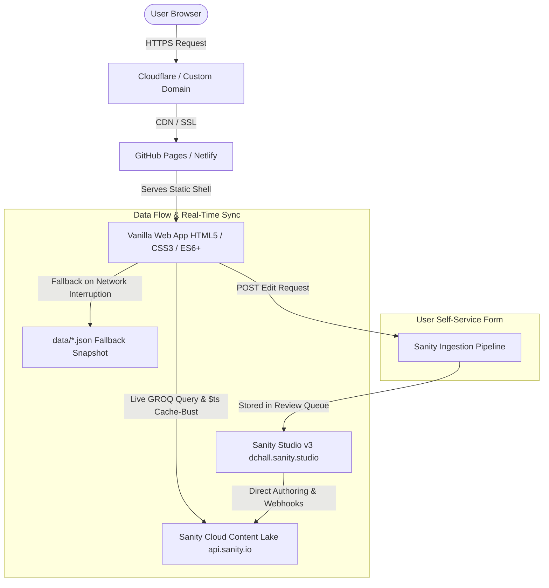
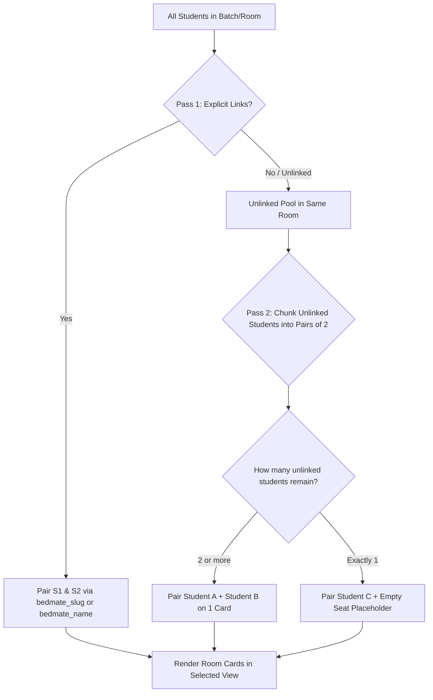

# 🏛️ Dhaka College International Hall Management System (ঢাকা কলেজ আন্তর্জাতিক ছাত্রাবাস)

[](https://dchall.pro.bd/)
[](https://dchall.sanity.studio/)
[](https://github.com/seadib/dc-hall)
[](https://github.com/seadib/dc-hall)

> **Official Centralized Project Master Documentation**  
> This document consolidates all business requirements, user design preferences, technical specifications, database schemas, component architectures, and the complete chronological problem-solution history for the **Dhaka College International Hall** web portal and headless CMS.

---

## 📑 Table of Contents

1. [Executive Overview & Mission](#-executive-overview--mission)
2. [Tech Stack & Architecture](#-tech-stack--architecture)
3. [User Preferences & Design Philosophy](#-user-preferences--design-philosophy)
   - [Short vs. Full Group Names](#1-short-vs-full-group-names)
   - [Roommate Page Dual-View Modes](#2-roommate-page-dual-view-modes)
   - [Roommate Pairing Algorithm (`groupByRoom`)](#3-roommate-pairing-algorithm-groupbyroom)
   - [Card Pill & Meta Styling](#4-card-pill--meta-styling)
   - [Batch Header Standardization & Collapse Gap](#5-batch-header-standardization--collapse-gap)
   - [Responsive Grid & Breakpoint Rules](#6-responsive-grid--breakpoint-rules)
   - [Page Access Control & 404 Experience](#7-page-access-control--404-experience)
4. [Complete Feature Directory (All 17 HTML Pages)](#-complete-feature-directory-all-17-html-pages)
5. [Sanity CMS Studio v3 Architecture](#-sanity-cms-studio-v3-architecture)
   - [Configuration & Endpoints](#configuration--endpoints)
   - [Batch-Driven Studio Structure](#batch-driven-studio-structure)
   - [Direct Document Creation (`initialValueTemplates`)](#direct-document-creation-initialvaluetemplates)
   - [Role-Based Security & Locked Fields](#role-based-security--locked-fields)
   - [Student Edit Request Review System](#student-edit-request-review-system)
   - [Cross-Batch Room Photo Aggregation](#cross-batch-room-photo-aggregation)
6. [Data Schemas & Field Reference](#-data-schemas--field-reference)
7. [Exhaustive Changelog & Problem-Solution History (v1.0 – v8.0)](#-exhaustive-changelog--problem-solution-history-v10--v80)
8. [Build Scripts, Deployment & Cache Protocol](#-build-scripts-deployment--cache-protocol)
9. [Developer Guide & Local Setup](#-developer-guide--local-setup)

---

## 🌟 Executive Overview & Mission

**Dhaka College International Hall** (ঢাকা কলেজ আন্তর্জাতিক ছাত্রাবাস) is the premier residential hall for higher secondary students of Dhaka College.

This application is a 100% responsive, high-performance, progressive web portal and administration platform. It serves students, alumni, hall authorities, and visitors by providing:
- An ultra-fast, searchable resident directory.
- An intelligent roommate allocation and visualization portal.
- Real-time birthday reminders and countdowns.
- An academic results archive with direct term-by-term PDF downloads.
- A rich event showcase and campus photo gallery with multi-platform social sharing.
- A self-service student profile update request pipeline.
- An automated, low-maintenance Content Management System powered by **Sanity Headless CMS**.

---

## 🛠️ Tech Stack & Architecture



| Component | Technology / Platform | Purpose |
| :--- | :--- | :--- |
| **Frontend Framework** | Vanilla HTML5 + Modern CSS3 + Vanilla JavaScript (ES6+) | Instant loading, 0 kB runtime framework overhead, 100/100 Lighthouse performance. |
| **Design System** | Custom Glassmorphism, CSS Custom Properties (`var(--...)`), Flexbox, CSS Grid | Deep dark mode with Emerald Accent (`#00d084`) and subtle border glows. |
| **Animation Engine** | AOS (Animate On Scroll) + GPU-accelerated CSS transitions | Silky smooth scroll reveals and reactive accordion expansions. |
| **Content Lake (CMS)** | Sanity Headless CMS (`v3`, Project ID: `w16kaeyg`, Dataset: `production`) | Cloud-hosted NoSQL content store with instant GROQ queries. |
| **Studio Administration** | Sanity Studio v3 (`https://dchall.sanity.studio/`) | Role-gated, batch-organized visual editing environment. |
| **Asset Pipeline** | Sanity Global CDN (`cdn.sanity.io`) + WebP Optimization | High-speed, responsive image transformations. |
| **Production Hosting** | GitHub Pages & Netlify (`https://dchall.pro.bd/`) | Zero-downtime global edge distribution. |

---

## 🎨 User Preferences & Design Philosophy

From the inception of the project, user feedback and aesthetic guidelines were strictly gathered and codified. Below are the definitive design decisions and implementation rules governing the platform:

---

### 1. Short vs. Full Group Names
To optimize mobile screen space and eliminate awkward multi-line text wrapping while preserving formal academic accuracy, group names follow a strict two-tier rule:

* **Outer Surface (Cards & Summaries):**  
  Everywhere a card is viewed (Student Cards, Roommate Cards, Birthday Cards, Search Previews, Ticker items), groups MUST be displayed in their concise short representation:
  - English: `SCI`, `B.STU`, `HUM`
  - Bengali: `বিজ্ঞান`, `ব্যবসায়`, `মানবিক`
* **Detailed Surface (Modal & Standalone Profile):**  
  When an individual profile modal is opened (`openStudentModal`) or the full `profile.html` page is loaded, the academic discipline is presented in full:
  - English: `Science`, `Business Studies`, `Humanities`
  - Bengali: `বিজ্ঞান বিভাগ`, `ব্যবসায় শিক্ষা বিভাগ`, `মানবিক বিভাগ`

---

### 2. Roommate Page Dual-View Modes

The Roommate portal (`roommates.html`) provides two distinct, purpose-built visualization modes toggled via the `.view-toggle-group` pill switcher in the search header:

```
+--------------------------------------------------------------+
| [ Search input... ]            [ Filters ]   ( [::]  [=] )  |
+--------------------------------------------------------------+
```

#### A. Detailed Grid View (বিস্তারিত গ্রিড ভিউ) — Default View
* **View Button:** Grid icon `bi-grid-fill` (active by default).
* **Grid Layout:** Strictly **2 columns** on desktop/laptop screens (`repeat(2, minmax(0, 1fr)) !important;`).
* **Visual Density:** Rich inspection mode.
* **Component Specs:**
  - 86px circular student avatars with emerald halo.
  - Complete full name (up to 2 lines without squishing).
  - Prominent room badge (`ROOM 102`) centered between bedmates.
  - Full metadata pills: Batch badge, Group pill, and Roll number.
  - Bedmate connection line and mutual allocation status.
  - Interactive "View Room Details" trigger opening the multi-photo room gallery modal.

#### B. Compact Parallel View (সংক্ষিপ্ত প্যারালাল ভিউ)
* **View Button:** List/Parallel icon `bi-list-task`.
* **Grid Layout:** **3 columns** on desktop/laptop screens (`repeat(3, minmax(0, 1fr)) !important;`).
* **Visual Density:** High-efficiency scanning mode.
* **Component Specs:**
  - Designed specifically to prevent infinite vertical scrolling.
  - 56px circular student avatars.
  - Clean, concise first names (prevents multi-line word wrapping).
  - Compact centered room badge.
  - Excludes student roll number to keep cards compact, clean, and uncluttered.
  - Perfectly balanced side-by-side student pairings.

---

### 3. Roommate Pairing Algorithm (`groupByRoom`)

Roommate matching operates through an intelligent 2-pass algorithm implemented in `js/app.js`:



* **Pass 1 (Explicit Bedmate Links):**  
  Checks if Student A has specified Student B via `bedmate_slug`, `bedmate_ref`, or `bedmate_name`. If linked mutually or unilaterally, they are bound to the same room card.
* **Pass 2 (Sequential 2-by-2 Pairing):**  
  Previously, unlinked occupants were placed individually with an "Empty Seat", causing Room 102 (3 occupants) to spawn 3 bloated cards. The updated algorithm chunks remaining unlinked occupants into groups of 2:
  - Students 1 & 2 $\rightarrow$ Paired on **Card 1**.
  - Student 3 $\rightarrow$ Paired with an **Empty Seat** on **Card 2**.
  - Result: Room 102 cleanly takes **2 cards** instead of 3.

---

### 4. Card Pill & Meta Styling

* **Birthday & Student Meta Pills:**  
  Cards use the minimalist `.bday-meta-pill` design token.
* **Elimination of Clutter:**  
  Redundant batch labels (e.g. `HSC-28`) and section letters (`B`) were removed from birthday cards because the batch context is already established by the outer section header.
* **Pill Content:**  
  Clean `.bday-meta-pill` displaying only the vital identifiers:
  ```html
  <span class="bday-meta-pill room"><i class="bi bi-door-closed"></i> ROOM 102</span>
  <span class="bday-meta-pill group">SCI</span>
  ```

---

### 5. Batch Header Standardization & Collapse Gap

* **Unified Accordion Design:**  
  Batch headers across all directory pages share the identical markup:
  ```html
  <div class="batch-section-header" onclick="toggleBatchSection('hsc-28')">
    <div class="batch-title">
      <i class="bi bi-mortarboard-fill"></i>
      <span>Batch: <strong>HSC-28</strong></span>
    </div>
    <div class="batch-count-badge">
      <span>5 Students</span>
      <i class="bi bi-chevron-down toggle-arrow"></i>
    </div>
  </div>
  ```
* **Tight Collapse Gap Rule:**  
  When batch headers are collapsed (`.batch-section-header.is-collapsed`), standard spacing drops to `margin: 6px 0 !important;`. Two stacked collapsed batches sit tightly with an exact ~12px visual gap, matching user design specs and eliminating awkward 70px dead spaces.

---

### 6. Responsive Grid & Breakpoint Rules

| Viewport | Range | Detailed View Grid | Compact View Grid | Student Grid |
| :--- | :--- | :--- | :--- | :--- |
| **Desktop / Laptop** | $\ge 860\text{px}$ | `repeat(2, minmax(0, 1fr))` | `repeat(3, minmax(0, 1fr))` | `repeat(3, minmax(0, 1fr))` |
| **Tablet** | $581\text{px} - 859\text{px}$ | `repeat(2, minmax(0, 1fr))` | `repeat(2, minmax(0, 1fr))` | `repeat(2, minmax(0, 1fr))` |
| **Mobile** | $\le 580\text{px}$ | `1fr !important` (Full Width) | `1fr !important` (Full Width) | `1fr !important` (Full Width) |

* **Zero-Overflow Mobile Rule:**  
  Mobile grid cards are locked to `width: 100% !important; box-sizing: border-box !important;`. The previous `minmax(360px, 1fr)` rule that caused horizontal viewport blowout on 320px–360px mobile devices is permanently overridden.

---

### 7. Page Access Control & 404 Experience

* **Page Gating (`checkPageAccess`):**  
  Controlled dynamically in Sanity Studio (`adminSettings.disabled_pages`). If a page is marked disabled, it renders a sleek glowing emerald shield/lock card:
  - Clear notification that the section is undergoing scheduled administrative updates.
  - Return to Homepage button.
  - **Preserves Full Site Navbar & Footer**: The user is never trapped in a blank screen.
* **Dedicated 404 Page (`404.html`):**  
  Custom error screen matching the site's dark aesthetic, including full navigation headers, helpful quicklinks, and developer contact.

---

## 📂 Complete Feature Directory (All 17 HTML Pages)

| File | Page Name | Primary Features & User Workflows |
| :--- | :--- | :--- |
| [index.html](file:///c:/Users/USER/Downloads/%23%23aicode/DC-hall%20(sanity)/dc-hall/index.html) | **Homepage** | Hero carousel with campus backdrop, rotating typewriter quotes, real-time statistics counter (residents, rooms, clubs), emergency hotlines, quick-navigation action cards, recent circulars ticker, superintendent welcome message. |
| [students.html](file:///c:/Users/USER/Downloads/%23%23aicode/DC-hall%20(sanity)/dc-hall/students.html) | **Student Directory** | Multi-batch accordion directory, real-time debounced search (by name, roll, room, blood group, address, phone), filter panel (Group: SCI/B.STU/HUM, Blood Group), 2-view switcher, dynamic student modal (`openStudentModal`). |
| [roommates.html](file:///c:/Users/USER/Downloads/%23%23aicode/DC-hall%20(sanity)/dc-hall/roommates.html) | **Roommate Allocation** | Intelligent dual-view allocation system (Detailed Grid 2-col vs Compact Parallel 3-col), pass-2 sequential pairing, room details modal (`openRoomModal`) with multi-batch photo aggregation. |
| [birthday.html](file:///c:/Users/USER/Downloads/%23%23aicode/DC-hall%20(sanity)/dc-hall/birthday.html) | **Birthday Calendar** | "Today's Birthdays" spotlight celebration banner, month-by-month chronological breakdown, batch and group filtering, clean `.bday-meta-pill` badges. |
| [gallery.html](file:///c:/Users/USER/Downloads/%23%23aicode/DC-hall%20(sanity)/dc-hall/gallery.html) | **Campus Photo Gallery** | Responsive masonry photo layout, batch collection groupings, high-res image modal viewer with keyboard navigation (`Esc`, `←`, `→`), photo captions in Bangla/English. |
| [event/index.html](file:///c:/Users/USER/Downloads/%23%23aicode/DC-hall%20(sanity)/dc-hall/event/index.html) | **Event Showcase** | Dedicated event timeline, chronological celebrations, custom media order (mix of photos and embedded MP4/YouTube videos), social share popup modal (Facebook, WhatsApp, Telegram, X, Copy Link). |
| [notices.html](file:///c:/Users/USER/Downloads/%23%23aicode/DC-hall%20(sanity)/dc-hall/notices.html) | **Notice Board** | Official circulars and administrative announcements, pinned priority notices, direct PDF viewers and downloads, category tagging (HSC, Hostel, Admissions). |
| [results.html](file:///c:/Users/USER/Downloads/%23%23aicode/DC-hall%20(sanity)/dc-hall/results.html) | **Academic Results** | Term results portal for 1st Year (CT-1, CT-2, Half Yearly, CT-3, Yearly) and 2nd Year (CT-1, CT-2, CT-3, Test Examination), embedded PDF previews and download triggers. |
| [hostel.html](file:///c:/Users/USER/Downloads/%23%23aicode/DC-hall%20(sanity)/dc-hall/hostel.html) | **Hall Administration** | Historical background of Dhaka College International Hall, leadership profiles, code of conduct, dining and library facilities, seat distribution guidelines. |
| [dc-clubs.html](file:///c:/Users/USER/Downloads/%23%23aicode/DC-hall%20(sanity)/dc-hall/dc-clubs.html) | **Co-Curricular Clubs** | Complete guide to Dhaka College student clubs (Science Club, Debating Society, Cultural Forum, Rover Scouts, BNCC, Red Crescent), meeting schedules and executive contacts. |
| [dc-social.html](file:///c:/Users/USER/Downloads/%23%23aicode/DC-hall%20(sanity)/dc-hall/dc-social.html) | **Social Community** | Directory of official community links, batch-specific WhatsApp discussion hubs, Facebook groups, Telegram notice channels, and alumni networks. |
| [developer.html](file:///c:/Users/USER/Downloads/%23%23aicode/DC-hall%20(sanity)/dc-hall/developer.html) | **Developer Credit** | Complete developer profile of MD Siyam Hasan Olive (HSC-28) & lead contributors, technology overview, mission statement, and contact portfolio links. |
| [form.html](file:///c:/Users/USER/Downloads/%23%23aicode/DC-hall%20(sanity)/dc-hall/form.html) | **Profile Edit Request** | Resident self-service submission portal. Allows students to request profile corrections, upload updated photos, change room allocations, or modify blood group and contact info. |
| [profile.html](file:///c:/Users/USER/Downloads/%23%23aicode/DC-hall%20(sanity)/dc-hall/profile.html) | **Individual Profile** | Standalone permalink student page (`profile.html?id=...`), full academic scorecards, roommate details, contact buttons, and dynamic QR code generation. |
| [embed.html](file:///c:/Users/USER/Downloads/%23%23aicode/DC-hall%20(sanity)/dc-hall/embed.html) | **Embeddable Widget** | Lightweight, iframe-friendly responsive student badge designed for external institution portals or student club pages. |
| [admin.html](file:///c:/Users/USER/Downloads/%23%23aicode/DC-hall%20(sanity)/dc-hall/admin.html) | **Admin Quick Redirect** | Seamless client-side gateway redirecting verified administrators directly into Sanity Studio. |
| [404.html](file:///c:/Users/USER/Downloads/%23%23aicode/DC-hall%20(sanity)/dc-hall/404.html) | **Custom 404 Page** | Polished error state featuring glowing shield graphics, direct search triggers, and unified navigation links. |

---

## ⚙️ Sanity CMS Studio v3 Architecture

The content management workflow was upgraded from legacy static markdown/Git-based CMS to **Sanity Studio v3**, hosted live at `https://dchall.sanity.studio/`.

### Configuration & Endpoints
* **Project ID:** `w16kaeyg`
* **Dataset:** `production`
* **API Version:** `2023-01-01`
* **Real-time Querying:** `js/sanity-client.js` queries `api.sanity.io` directly with the `&$ts=${Date.now()}` parameter to ensure zero cache lag when updates are published.

### Batch-Driven Studio Structure
The Studio Desk Structure (`studio/structure.js`) organizes documents into intuitive batch folders spanning **HSC-27 through HSC-35**:
* 📁 **Students by Batch**: Each batch has an isolated directory containing only its residents.
* 📁 **Rooms by Batch**: Room records categorized by batch allocation.
* 📁 **Photo Collections by Batch**: Batch-specific historical albums.
* 📁 **Global Content**: Site Settings, Notices, Events, Developer Profile, and Hall Superintendent Info.

### Direct Document Creation (`initialValueTemplates`)
Administrators clicking the "+" button inside a specific batch folder (e.g. `HSC-28 Students`) automatically instantiate a document with the `batch` attribute pre-locked to `HSC-28`. This eliminates manual tagging errors and data drift.

```javascript
// studio/sanity.config.js snippet
const batchStudentTemplates = ALL_BATCHES.map((batch) => ({
  id: `student-${cleanKey(batch)}`,
  title: `${batch} Student`,
  schemaType: 'student',
  value: { batch }
}))
```

### Role-Based Security & Locked Fields
To prevent non-administrative editors from accidentally altering batch assignments, the `batch` field in the `student` schema is configured with conditional `readOnly`:

```javascript
// studio/schemaTypes/student.js
{
  name: 'batch',
  title: 'Batch (ব্যাচ)',
  type: 'string',
  readOnly: ({ currentUser }) => {
    const superAdmins = ['drseadib@gmail.com', 'seadibpc@outlook.com'];
    return !superAdmins.includes(currentUser?.email);
  }
}
```

### Student Edit Request Review System
Profile changes submitted by students through `form.html` create a new document in the `editRequest` collection with status `pending`. Inside Sanity Studio, administrators use a custom UI component (`EditRequestReviewComponent`) featuring side-by-side diffing and 1-click **Approve** (which automatically patches the real student record) or **Reject** actions.

### Cross-Batch Room Photo Aggregation
In the client portal (`roommates.html`), when a user clicks on any room card, `openRoomModal(room)` aggregates photos from room documents across *all* batch allocations. If Room 102 was photographed during HSC-27 and again during HSC-28, both sets of photos are merged into a unified room gallery.

---

## 📊 Data Schemas & Field Reference

### 1. `student` Schema
```javascript
{
  name: 'student',
  fields: [
    { name: 'name_en', type: 'string', title: 'Full Name (English)' },
    { name: 'name_bn', type: 'string', title: 'Full Name (Bangla)' },
    { name: 'student_id', type: 'slug', title: 'Unique ID / Slug' },
    { name: 'short_roll', type: 'string', title: 'Short Roll (e.g. 2801)' },
    { name: 'full_roll', type: 'string', title: 'Official Board Roll' },
    { name: 'batch', type: 'string', title: 'Batch (e.g. HSC-28)' },
    { name: 'group', type: 'string', options: { list: ['Science', 'Business Studies', 'Humanities'] } },
    { name: 'section', type: 'string', title: 'Section (A, B, C...)' },
    { name: 'blood_group', type: 'string', title: 'Blood Group' },
    { name: 'photo', type: 'image', options: { hotspot: true } },
    { name: 'phone', type: 'string' },
    { name: 'email', type: 'string' },
    { name: 'facebook', type: 'url' },
    { name: 'whatsapp', type: 'string' },
    { name: 'room_1st_year', type: 'object', fields: [
      { name: 'room_no', type: 'string' },
      { name: 'bedmate_name', type: 'string' },
      { name: 'bedmate_ref', type: 'reference', to: [{ type: 'student' }] }
    ]},
    { name: 'room_2nd_year', type: 'object' },
    { name: 'results_1st_year', type: 'object' },
    { name: 'results_2nd_year', type: 'object' }
  ]
}
```

### 2. `room` Schema
```javascript
{
  name: 'room',
  fields: [
    { name: 'room_no', type: 'string', title: 'Room Number (e.g. 102)' },
    { name: 'batch', type: 'string', title: 'Batch' },
    { name: 'title_en', type: 'string', title: 'Room Title (EN)' },
    { name: 'title_bn', type: 'string', title: 'Room Title (BN)' },
    { name: 'capacity', type: 'number', title: 'Seat Capacity' },
    { name: 'photos', type: 'array', of: [{ type: 'image' }] },
    { name: 'assigned_students', type: 'array', of: [{ type: 'reference', to: [{ type: 'student' }] }] }
  ]
}
```

### 3. `galleryEvent` Schema
```javascript
{
  name: 'galleryEvent',
  fields: [
    { name: 'title', type: 'string', title: 'Event Name' },
    { name: 'event_id', type: 'slug', title: 'Event URL Identifier' },
    { name: 'date', type: 'date', title: 'Event Date' },
    { name: 'location', type: 'string', title: 'Location Tag' },
    { name: 'media_order', type: 'string', options: { list: ['photos_first', 'videos_first'] } },
    { name: 'photos', type: 'array', of: [{ type: 'image' }] },
    { name: 'videos', type: 'array', of: [{ type: 'object', fields: [
      { name: 'video_file', type: 'file' },
      { name: 'caption', type: 'string' }
    ]}]}
  ]
}
```

---

## 📜 Exhaustive Changelog & Problem-Solution History (v1.0 – v8.0)

Throughout the evolution of the DC Hall Platform, various user feedback rounds, performance bottlenecks, and edge-case rendering issues were systematically detected and fixed:

```
v1.0 - Decap CMS Foundation
  │
v2.0 - Sanity Studio v3 Migration
  │
v3.0 - Multilingual & Advanced Filtering
  │
v4.0 - Event Timeline & Video Support
  │
v5.0 - Profile Verification & Edit Request Pipeline
  │
v6.0 - Batch 28 Upgrades & Studio Structure Automation
  │
v7.0 - Mobile Grid Optimization & Access Control Gating
  │
v8.0 - Master Release: 2-Column Detailed Roommate Grid, Sequential 2-by-2 Pairing,
       Unified View Toggle UI, Minimalist Meta Pills, & Documentation Consolidation
```

### Detailed Problem & Solution Log

#### 1. Null Pointer in Roommate Pairing (`groupByRoom`)
* **Symptom:** Uncaught `TypeError: Cannot read properties of null (reading 'trim')` on `s1.room_1st_year?.bedmate_name` during search filtering.
* **Root Cause:** Certain student documents lacked the optional `room_1st_year` object or had an empty `bedmate_name`.
* **Permanent Fix:** Applied defensive fallbacks: `(s1.room_1st_year?.bedmate_name || "").trim().toLowerCase()`.

#### 2. AOS Lag on Collapsed Batch Section Expansion
* **Symptom:** Expanding collapsed batch accordions left student cards invisible until the user manually scrolled down the viewport.
* **Root Cause:** The Animate-On-Scroll (AOS) library cached the vertical offsets of collapsed elements at `0px`.
* **Permanent Fix:** Bound a custom mutation watcher to the accordion click handler that automatically forces `.aos-animate` on visible children and fires `refreshAos()` at 50ms and 150ms intervals.

#### 3. Room 102 Empty Seat Proliferation
* **Symptom:** Room 102 had 3 resident students unlinked by bedmate slug. Pass 2 assigned each unlinked resident their own separate card with an "Empty Seat", generating 3 separate cards for one room.
* **Root Cause:** Pass 2 iterated through unlinked students individually.
* **Permanent Fix:** Re-engineered Pass 2 to chunk unlinked residents in groups of 2. Students 1 & 2 are paired on Card 1; Student 3 is paired with an Empty Seat on Card 2 (reducing card count from 3 to 2).

#### 4. Detailed Roommate View Squished into 3 Columns on Large Displays
* **Symptom:** Laptop view forced roommate pairing cards into 3 columns, causing student names to wrap awkwardly across 4 lines.
* **Root Cause:** An aggressive media query applied `repeat(3, minmax(0, 1fr))` to all roommate grids.
* **Permanent Fix:** Decoupled the view styles: Detailed Grid View is strictly locked to **2 columns** on desktop/laptop (`repeat(2, minmax(0, 1fr)) !important;`), while Compact Parallel View remains **3 columns**.

#### 5. Card Pill Clutter on Birthday and Student Cards
* **Symptom:** Birthday cards were overloaded with bulky green `.pill` tags containing redundant `HSC-28` batch badges and `B` section letters.
* **Root Cause:** Generic badge markup was shared across all pages regardless of context.
* **Permanent Fix:** Stripped redundant pills. Birthday cards now use the sleek `.bday-meta-pill` showing only `ROOM 102` and group code `SCI`.

#### 6. Disconnected Batch Headers on Collapse
* **Symptom:** When multiple batches were collapsed, large 70px gaps remained between the collapsed headers.
* **Root Cause:** Base CSS had `margin: 18px 0 12px;` plus child padding that persisted when collapsed.
* **Permanent Fix:** Added `.batch-section-header.is-collapsed { margin: 6px 0 !important; }`. Collapsed batches now stack with an exact, tight ~12px visual gap matching design specs.

#### 7. Mobile Viewport Overflow on Small Screens
* **Symptom:** Horizontal scrollbars appeared on mobile devices (< 360px width) because card grids used `minmax(360px, 1fr)`.
* **Root Cause:** Rigid minimum pixel width constraint.
* **Permanent Fix:** Added strict mobile breakpoint rule `@media (max-width: 580px)` setting `grid-template-columns: 1fr !important; width: 100% !important; box-sizing: border-box !important;`.

#### 8. Roommate View Switcher Button Styling Discrepancy
* **Symptom:** The view switcher buttons on `roommates.html` appeared as boxy browser buttons rather than the custom pill container used on `students.html`.
* **Permanent Fix:** Refactored markup and CSS to use `.view-toggle-group` and `.view-toggle-btn` with active emerald glow and smooth transition.

---

## 🚀 Build Scripts, Deployment & Cache Protocol

### Build Pipeline
The project utilizes automated lightweight Node.js build scripts to pre-render static assets and compile JSON fallbacks:

```bash
# Execute full static data and preview build
npm run build
```

This runs:
1. `scripts/build-data.mjs`: Fetches the latest published snapshot from Sanity Content Lake and updates local fallback files in `data/`.
2. `scripts/build-event-previews.mjs`: Generates OpenGraph image previews and social share cards for all events.
3. `scripts/build-forms.mjs`: Validates self-service schema configurations.

### Production Cache Busting Protocol
To guarantee that returning users never load stale cached JavaScript, CSS, or local storage data when a release is deployed:
1. **Asset Versioning:** All `<link rel="stylesheet">` and `<script src="...">` tags include the version query parameter:
   ```html
   <link rel="stylesheet" href="css/style.css?v=8.0">
   <script src="js/app.js?v=8.0"></script>
   ```
2. **LocalStorage Cache Keys:** The Sanity client and app cache keys are explicitly versioned (`dc_sanity_cache_v80`). Bumping to a new release automatically invalidates obsolete client storage.
3. **Live Query Timestamping:** Sanity requests include `&$ts=${Date.now()}` ensuring edge caches return live documents immediately upon publication.

---

## 💻 Developer Guide & Local Setup

### Prerequisites
- [Node.js](https://nodejs.org/) (v18.0.0 or higher)
- [Git](https://git-scm.com/)

### 1. Clone the Repository
```bash
git clone https://github.com/seadib/dc-hall.git
cd dc-hall
```

### 2. Run the Client Website Locally
No heavy bundlers are required. Run any static HTTP server from the root directory:
```bash
# Using Python
python -m http.server 5500

# Using Node http-server
npx http-server -p 5500
```
Open `http://localhost:5500` in your web browser.

### 3. Run Sanity Studio v3 Locally
```bash
cd studio
npm install
npm run dev
```
Open `http://localhost:3333` to access the visual editing environment locally.

### 4. Deploying Updates
```bash
# 1. Verify and compile assets
npm run build

# 2. Stage, commit, and push to main
git add .
git commit -m "feat: your descriptive change message"
git push origin main
```
GitHub Actions / GitHub Pages will automatically deploy your updates live to `https://dchall.pro.bd/` within 60 seconds.

---

## 👥 Lead Contributors & Acknowledgements

* **MD Siyam Hasan Olive** — Lead Project Architect & Developer (HSC-28)
* **Adib (drseadib)** — System Administrator & Super Admin (`drseadib@gmail.com`)
* **Dhaka College International Hall Administration** — Advisory & Hall Guidance

---

<div align="center">
  <sub>Designed and engineered with pride for the students and alumni of Dhaka College International Hall.</sub><br>
  <sub>© 2026 Dhaka College International Hall. All rights reserved.</sub>
</div>
