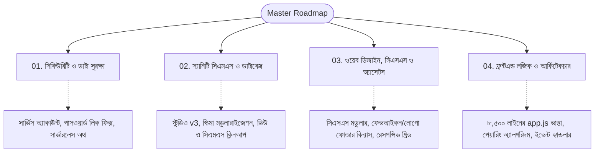

# 🗺️ Dhaka College International Hall - মাস্টার রোডম্যাপ ও ভার্সন কন্ট্রোল

> **বর্তমান ভার্সন:** `v8.1`  
> **পরবর্তী টার্গেট ভার্সন:** `v8.2` (সিকিউরিটি হার্ডেনিং)  
> **তৈরি তারিখ:** ৮ নভেম্বর, ২০২৬  
> **প্রজেক্ট নাম:** ঢাকা কলেজ আন্তর্জাতিক ছাত্রাবাস ওয়েব পোর্টাল ও ম্যানেজমেন্ট সিস্টেম  
> **লাইভ সাইট:** [dchall.pro.bd](https://dchall.pro.bd/) | **স্যানিটি স্টুডিও:** [dchall.sanity.studio](https://dchall.sanity.studio/)  

---

## 🏷️ ভার্সন রিলিজ রোডম্যাপ (Version Milestones)

| ভার্সন ট্যাগ | ফোকাস এরিয়া | মূল কাজসমূহ | স্ট্যাটাস |
| :--- | :--- | :--- | :--- |
| **v8.1** | স্টুডেন্ট ও রুমমেট ভিউ | ৩-কলাম ব্লিড ফিক্স, নাম র‍্যাপিং ফিক্স, সেন্ট্রালাইজড ডকস | ✅ সম্পন্ন |
| **v8.2** | সিকিউরিটি ও প্রাইভেসি | `service_account.json` প্রটেকশন, পাসওয়ার্ড লিক ফিক্স, GROQ কুয়েরি ফিল্টার, SHA-256 হ্যাশ | ✅ সম্পন্ন |
| **v8.3** | ফাইল ও ডিরেক্টরি ক্লিনআপ | রুট ফেভআইকন স্থানান্তর, পুরনো ডেক্যাপ সিএমএস ও পাওয়ারশেল স্ক্রিপ্ট ক্লিনআপ | ✅ সম্পন্ন |
| **v8.4** | CSS মডুলারাইজেশন | ১৪৫ KB `style.css` কে ১০টি মডিউল, `build-css.mjs` ও `@import` ম্যানিফেস্টে রূপান্তর | ✅ সম্পন্ন |
| **v8.5** | জাভাস্ক্রিপ্ট ও কম্পোনেন্ট রিফ্যাক্টরিং | ১,৮০০+ লাইন মক ডাটা অপসারণ, ১৪টি HTML পেজে ফুটার ডুপ্লিকেশন দূর, `js/modules/` ও নন-ডেভেলপার ফ্রেন্ডলি লগ সংযোজন | ✅ সম্পন্ন |

---

## 📌 ওভারভিউ ও মূল উদ্দেশ্য

এই প্রজেক্টের সমস্ত কাজ, অ্যানালাইসিস এবং ভবিষ্যতের পরিবর্তনগুলোকে ৪টি সুনির্দিষ্ট মডিউল ফাইলে ভাগ করা হয়েছে। প্রতিটি মডিউলে কাজ করার সাথে সাথে সেই ফাইলের লগ এবং স্ট্যাটাস আপডেট হবে।

---

## 📂 মডিউল ফাইল ইনডেক্স

| ফাইল নাম | মূল বিষয়বস্তু | বর্তমান অবস্থা |
| :--- | :--- | :--- |
| [01_SECURITY_AND_AUTH.md](file:///c:/Users/USER/Downloads/%23%23aicode/DC-hall%20(sanity)/dc-hall/docs/01_SECURITY_AND_AUTH.md) | পাসওয়ার্ড সিকিউরিটি, সার্ভিস একাউন্ট কি প্রটেকশন, স্টুডেন্ট প্রাইভেসি, ক্লায়েন্ট-সাইড বাইপাস রোধ | 🔴 জরুরি অ্যাকশন প্রয়োজন |
| [02_SANITY_CMS_AND_STUDIO.md](file:///c:/Users/USER/Downloads/%23%23aicode/DC-hall%20(sanity)/dc-hall/docs/02_SANITY_CMS_AND_STUDIO.md) | Sanity Studio v3, ডেটাবেস স্কিমা, অ্যাডমিন সেটিংস, ডেস্ক স্ট্রাকচার, ডেক্যাপ সিএমএস অপসারণ | 🟡 স্ট্রাকচার্ড, রিফ্যাক্টরিং বাকি |
| [03_DESIGN_CSS_AND_ASSETS.md](file:///c:/Users/USER/Downloads/%23%23aicode/DC-hall%20(sanity)/dc-hall/docs/03_DESIGN_CSS_AND_ASSETS.md) | ১৪৫ KB CSS ফাইল স্প্লিট, রুট ডিরেক্টরি থেকে ১৪টি ফেভআইকন ও স্ক্রিপ্ট গুছানো, ক্লিন অ্যাসেট ফোল্ডার | 🟡 অ্যানালাইসিস সম্পন্ন, স্থানান্তর বাকি |
| [04_LOGIC_AND_ARCHITECTURE.md](file:///c:/Users/USER/Downloads/%23%23aicode/DC-hall%20(sanity)/dc-hall/docs/04_LOGIC_AND_ARCHITECTURE.md) | ৩৯৫ KB (৮,৫০০+ লাইন) `app.js` কে আলাদা আলাদা মডিউলে বিভক্ত করা, রুমমেট পেয়ারিং ও সার্চ ফিল্টার | 🟡 অ্যানালাইসিস সম্পন্ন, স্প্লিটিং বাকি |

---

## 🎯 বাস্তবায়ন ধাপসমূহ (Action Plan)

1. **ফেজ ১: সিকিউরিটি ইমিডিয়েট ফিক্স (Urgent)**
   - রুট ডিরেক্টরি থেকে `service_account.json` নিরাপদ স্থানে সরানো।
   - `adminSettings` থেকে `master_password` পাবলিক GROQ কুয়েরি থেকে ফিল্টার করা।
   - ক্লায়েন্ট-সাইডে হার্ডকোডেড পাসওয়ার্ড মুছে ফেলা।
2. **ফেজ ২: অ্যাসেট ও রুট ক্লিনআপ (Housekeeping)**
   - রুট ফোল্ডারে থাকা সমস্ত ফেভআইকন `assets/favicons/` ফোল্ডারে সরানো।
   - সমস্ত `.ps1` ও `.bat` ফাইল `scripts/powershell/` এ গুছানো।
   - অপ্রয়োজনীয় `css/js` ডিরেক্টরি ও পুরনো Decap CMS `admin/` সরানো।
3. **ফেজ ৩: CSS ও ডিজাইন সিস্টেম মডুলারাইজেশন**
   - `style.css` কে `variables.css`, `layout.css`, `components.css`, `pages.css` এ রূপান্তর।
4. **ফেজ ৪: জাভাস্ক্রিপ্ট আর্কিটেকচার রিফ্যাক্টরিং**
   - `app.js` কে ছোট ছোট রিইউজেবল ES মডিউলে ভাগ করা।
5. **ফেজ ৫: স্যানিটি স্টুডিও ও ডাটাবেস ফাইনাল অপটিমাইজেশন**
   - স্কিমা টাইপস ক্লিনআপ এবং স্টুডিও পারফরম্যান্স টিউনিং।
