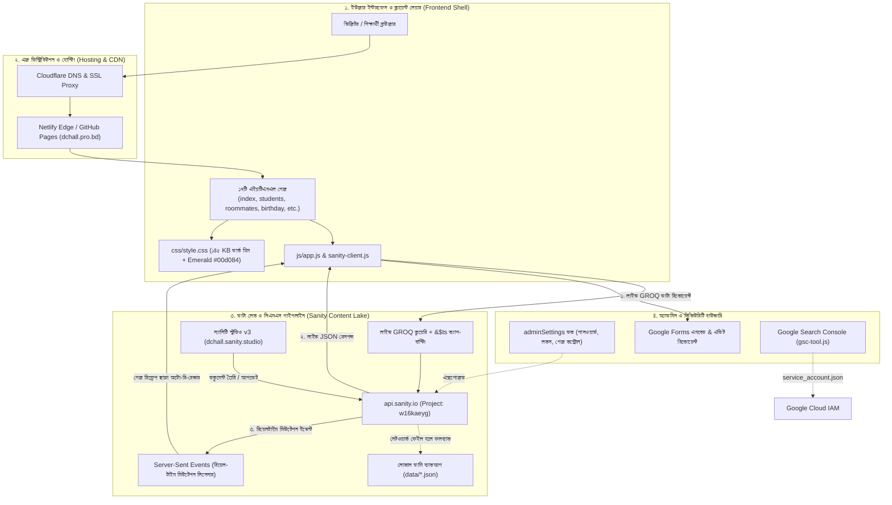

# ⚙️ মডিউল ৪: ফ্রন্টএন্ড লজিক ও আর্কিটেকচার (Logic & Architecture)

> **ফাইলের অবস্থান:** `dc-hall/docs/04_LOGIC_AND_ARCHITECTURE.md`  
> **সর্বশেষ আপডেট:** ৮ নভেম্বর, ২০২৬  
> **স্ট্যাটাস:** 🟡 ৩৯৫ KB মোনোলিথিক কোড চিহ্নিত, পূর্ণাঙ্গ আর্কিটেকচার ডায়াগ্রাম ও মডুলার প্ল্যান প্রস্তুত

---

## 🌐 ওয়েবসাইটের পেজ ও কন্টেন্ট ইনফরমেশন আর্কিটেকচার (Information Architecture & Page Relations)

হোমপেজ (`index.html`)-কে কেন্দ্র করে পুরো ওয়েবসাইটের ১৭টি পেজ, তাদের সেকশন এবং ডেটা সংযোগের পূর্ণাঙ্গ ট্রি (Tree) নিচে দেওয়া হলো:

```mermaid
graph TD
    Home["🏠 হোমপেজ (index.html)<br/>(মূল হাব ও সেন্ট্রাল গেটওয়ে)"]

    %% হোমপেজের ইন্টারনাল সেকশনসমূহ
    subgraph HomeSections["হোমপেজের মূল সেকশনসমূহ"]
        H_Hero["১. হিরো ব্যানার ও টাইপরাইটার কোটস"]
        H_Ticker["২. জরুরি নোটিশ ও সার্কুলার স্ক্রলার"]
        H_Stats["৩. লাইভ কাউন্টার (ছাত্র, রুম, ক্লাব সংখ্যা)"]
        H_Students["৪. স্টুডেন্ট ডিরেক্টরি প্রিভিউ"]
        H_Rooms["৫. রুমমেট ও আসন প্রিভিউ"]
        H_Results["৬. একাডেমিক রেজাল্ট প্রিভিউ"]
        H_Super["৭. হল সুপার পরিচিতি ও বাণী"]
        H_Moments["৮. ক্যাম্পাস মেমোরিজ / ফটো প্রিভিউ"]
        H_Clubs["৯. কলেজ কো-কারিকুলার রিসোর্স"]
    end

    %% সংযুক্ত অন্যান্য মূল পেজসমূহ
    subgraph AcademicPages["একাডেমিক ও শিক্ষার্থী পোর্টাল"]
        StudentsPage["👥 students.html<br/>(মাল্টি-ব্যাচ অ্যাকর্ডিয়ন, ফিল্টার ও সার্চ)"]
        ProfilePage["👤 profile.html?id=...<br/>(ব্যক্তিগত প্রোফাইল ও QR কার্ড)"]
        RoommatesPage["🚪 roommates.html<br/>(২-কলাম গ্রিড ও ৩-কলাম প্যারালাল ভিউ)"]
        ResultsPage["📊 results.html<br/>(১ম ও ২য় বর্ষের টার্ম রেজাল্ট ও PDF)"]
        BirthdayPage["🎂 birthday.html<br/>(আজকের জন্মদিন ও ক্যালেন্ডার)"]
    end

    subgraph AdminNoticePages["নোটিশ, ফর্ম ও প্রশাসন"]
        NoticesPage["📢 notices.html<br/>(অফিসিয়াল নোটিশ ও PDF ডাউনলোড)"]
        FormPage["📝 form.html?f=...<br/>(গুগল ফর্ম এমবেড ও আবেদন)"]
        HostelPage["🏛️ hostel.html<br/>(হল পরিচিতি, সিট বণ্টন ও সুযোগ-সুবিধা)"]
        HallSuperPage["👨‍🏫 hallsuper.html<br/>(হল সুপারের বিস্তারিত প্রোফাইল)"]
    end

    subgraph MediaCommunityPages["মিডিয়া ও সোশ্যাল নেটওয়ার্ক"]
        GalleryPage["🖼️ gallery.html<br/>(ক্যাম্পাস ফটো গ্যালারি ও মেসনরি গ্রিড)"]
        EventPages["🎉 event/*.html<br/>(ইভেন্ট টাইমলাইন, ভিডিও ও শেয়ার)"]
        ClubsPage["⚽ dc-clubs.html<br/>(৬টি ক্লাবের তালিকা ও কমিটি)"]
        SocialPage["💬 dc-social.html<br/>(হোয়াটসঅ্যাপ, ফেসবুক ও টেলিগ্রাম হাব)"]
    end

    subgraph MetaSystemPages["সিস্টেম ও সাপোর্ট পেজ"]
        DeveloperPage["🧑‍💻 developer.html<br/>(ডেভেলপার ও কন্ট্রিবিউটর টিম)"]
        AdminGateway["🔐 admin.html<br/>(স্যানিটি স্টুডিও রিডাইরেক্ট)"]
        NotFound["🛡️ 404.html<br/>(কাস্টম এরর ও ব্যাক নেভিগেশন)"]
    end

    %% সংযোগ রেখাসমূহ
    Home --> HomeSections
    H_Students --> StudentsPage
    StudentsPage -->|ক্লিক করলে মোডাল বা পারমালিংক| ProfilePage
    H_Rooms --> RoommatesPage
    H_Results --> ResultsPage
    H_Ticker --> NoticesPage
    H_Moments --> GalleryPage
    GalleryPage --> EventPages
    H_Clubs --> ClubsPage
    H_Super --> HallSuperPage
    Home --> BirthdayPage
    Home --> FormPage
    Home --> HostelPage
    Home --> SocialPage
    Home --> DeveloperPage
    Home --> AdminGateway
```



---

### 📑 পেজ-ভিত্তিক ডেটা সংযোগ ও ব্যবহারকারী ফ্লো (User Journey)

| পেজের নাম ও ইউআরএল | হোমপেজের যে সেকশন থেকে যুক্ত | যে ডেটা লোড করে (Sanity / Local) | মূল ইন্টারঅ্যাকশন ও সাব-কম্পোনেন্ট |
| :--- | :--- | :--- | :--- |
| **১. [index.html](file:///c:/Users/USER/Downloads/%23%23aicode/DC-hall%20(sanity)/dc-hall/index.html)** | মূল ডিরেক্টরি | `homePage`, `siteSettings`, `students`, `rooms` | হিরো ক্যারোজেল, কাউন্টার অ্যানিমেশন, অ্যাকশন কার্ডস, ফুটার। |
| **২. [students.html](file:///c:/Users/USER/Downloads/%23%23aicode/DC-hall%20(sanity)/dc-hall/students.html)** | "View All Students" বাটন | `students` কালেকশন (HSC-27 থেকে HSC-35) | রিয়েলটাইম সার্চ, গ্রুপ ও ব্লাড গ্রুপ ফিল্টার, স্টুডেন্ট পপআপ মোডাল। |
| **৩. [roommates.html](file:///c:/Users/USER/Downloads/%23%23aicode/DC-hall%20(sanity)/dc-hall/roommates.html)** | "Explore Rooms" বাটন | `students`, `rooms` (ক্রস-ব্যাচ ম্যাপিং) | ডিটেইল্ড গ্রিড (২-কলাম) বনাম প্যারালাল ভিউ (৩-কলাম), রুম ফটো মোডাল। |
| **৪. [birthday.html](file:///c:/Users/USER/Downloads/%23%23aicode/DC-hall%20(sanity)/dc-hall/birthday.html)** | কুইক অ্যাকশন ন্যাভবার | `students` (DOB ফিল্ড) | "Today's Celebration" স্পটলাইট ব্যানার, মাসভিত্তিক তালিকা। |
| **৫. [results.html](file:///c:/Users/USER/Downloads/%23%23aicode/DC-hall%20(sanity)/dc-hall/results.html)** | "Results Archive" বাটন | `students.results_1st_year`, `results_2nd_year` | CT-1, CT-2, Half Yearly, Test পরীক্ষার PDF প্রিভিউ ও ডাউনলোড। |
| **৬. [notices.html](file:///c:/Users/USER/Downloads/%23%23aicode/DC-hall%20(sanity)/dc-hall/notices.html)** | নোটিশ টিকার লিংক | `notices` কালেকশন | পিন করা নোটিশ, HSC ও হোস্টেল নোটিশ ক্যাটাগরি, অফিসিয়াল PDF ভিউ। |
| **৭. [gallery.html](file:///c:/Users/USER/Downloads/%23%23aicode/DC-hall%20(sanity)/dc-hall/gallery.html)** | "Campus Moments" সেকশন | `galleryItem`, `galleryEvents` | ফুলস্ক্রিন ইমেজ লাইটবক্স, কিবোর্ড নেভিগেশন (Esc/অ্যারো কি)। |
| **৮. [event/*.html](file:///c:/Users/USER/Downloads/%23%23aicode/DC-hall%20(sanity)/dc-hall/event/)** | গ্যালারির ইভেন্ট কার্ড | `galleryEvent` | মাল্টিমিডিয়া শোকেস (ভিডিও + ফটো), সোশ্যাল শেয়ারিং ডায়ালগ। |
| **৯. [form.html](file:///c:/Users/USER/Downloads/%23%23aicode/DC-hall%20(sanity)/dc-hall/form.html)** | হেডার আবেদন লিংক | `hallForm` (স্ল্যাগ যেমন `?f=hsc27`) | গুগল ফর্ম অটো-এমবেড, রেসপন্সিভ আইফ্রেম। |
| **১০. [hostel.html](file:///c:/Users/USER/Downloads/%23%23aicode/DC-hall%20(sanity)/dc-hall/hostel.html)** | "Hall Administration" | `hallInfo` | ইতিহাস, আসন বণ্টন নিয়মাবলী, প্রাক্তন কৃতি শিক্ষার্থী চার্ট। |
| **১১. [dc-clubs.html](file:///c:/Users/USER/Downloads/%23%23aicode/DC-hall%20(sanity)/dc-hall/dc-clubs.html)** | "Clubs & Resources" কার্ড | স্ট্যাটিক + স্যানিটি রিলেটেড | সায়েন্স ক্লাব, ডিবেটিং ক্লাব, বিএনসিসি, রোভার স্কাউটস কন্ট্যাক্ট। |
| **১২. [developer.html](file:///c:/Users/USER/Downloads/%23%23aicode/DC-hall%20(sanity)/dc-hall/developer.html)** | ফুটার ক্রেডিট লিংক | `developerProfile` | ডেভেলপার সিয়াম হাসান অলিভ (HSC-28) ও কন্ট্রিবিউটর প্রোফাইল। |

---

## 🏗️ সম্পূর্ণ সিস্টেম আর্কিটেকচার ব্লুপ্রিন্ট (Full Architecture Diagram)



---

## 🔍 বর্তমান জাভাস্ক্রিপ্ট কোডবেজ বিশ্লেষণ

### ১. দানবাকৃতি `app.js` মোনোলিথ (Monolithic JavaScript)
- **ফাইল:** [`dc-hall/js/app.js`](file:///c:/Users/USER/Downloads/%23%23aicode/DC-hall%20(sanity)/dc-hall/js/app.js)
- **সাইজ:** ~৩৯৫ KB (৮,৫৫৪ লাইন!)
- **সমস্যা:** 
  - একই ফাইলে বাংলা ও ইংরেজির অনুবাদ ডিকশনারি (i18n),
  - হার্ডকোডেড ব্যাকআপ ডাটা (শত শত লাইনের স্টুডেন্ট ও রুমের ডামি তথ্য),
  - ওয়েব অডিও সিন্থেসাইজার (সাউন্ড ইফেক্ট অসিলেটর),
  - পাসওয়ার্ড যাচাই ও লোকাল স্টোরেজ সেশন চেকার,
  - রুমমেট পেয়ারিং অ্যালগরিদম,
  - লাইভ সার্চ ও মাল্টি-ফিল্টার লজিক,
  - মোডাল উইন্ডো ও ইমেজ প্রিভিউয়ার কোড—সব একক ফাইলে জটলা পাকিয়ে আছে।
- **ঝুঁকি:** একটি সাধারণ বাগ ফিক্স করতে গেলেও পুরো ৮,৫০০ লাইনের ফাইলে অনাকাঙ্ক্ষিত সাইড-ইফেক্ট হওয়ার আশঙ্কা থাকে।

### ২. মূল অ্যালগরিদম ও ফিচারসমূহ
- **রুমমেট পেয়ারিং অ্যালগরিদম (`groupByRoom`):**
  - **Pass 1:** সরাসরি `bedmate_ref` বা `bedmate_name` অনুযায়ী লিংক করা।
  - **Pass 2:** আনলিংকড ছাত্রদের ক্রমানুসারে জোড়ায় জোড়ায় (Chunk in 2s) ভাগ করে কার্ড তৈরি করা। বিজোড় সংখ্যা হলে একটি ফাঁকা সিট (Empty Seat) দিয়ে কার্ড তৈরি।
- **লাইভ ফিল্টারিং সিস্টেম:**
  - ব্যাচ অনুযায়ী অ্যাকর্ডিয়ন সেকশন।
  - রিয়েল-টাইম ডিবউন্সড সার্চ (নাম, রোল, রুম, রক্তের গ্রুপ, জেলা অনুযায়ী ফিল্টার)।
- **মাল্টি-ল্যাঙ্গুয়েজ সুইচিং (i18n):**
  - বাংলা (`bn`) ও ইংরেজি (`en`) টগল।
  - শর্ট গ্রুপ নাম (`SCI`, `B.STU`, `HUM`) বনাম ফুল নাম (`Science`, `Business Studies`, `Humanities`) ডিসপ্লে লজিক।

### ৩. প্রস্তাবিত মডুলার ES6+ আর্কিটেকচার
`app.js` কে ভেঙে নিম্নোক্ত রিইউজেবল মডিউলে বিভক্ত করা হবে:
```
js/
├── main.js                   # পেজ এন্ট্রি পয়েন্ট ও ইনিশিয়ালাইজার
├── sanity-client.js          # GROQ ফেচ ও SSE লাইভ লিসেনার
└── modules/
    ├── i18n.js               # ভাষা পরিবর্তন ও অনুবাদ অভিধান
    ├── auth.js               # সেশন ভেরিফিকেশন ও রোল ম্যানেজমেন্ট
    ├── roommatePairing.js    # ২-পাস রুমমেট অ্যালগরিদম
    ├── studentDirectory.js   # সার্চ, ফিল্টার, অ্যাকর্ডিয়ন লজিক
    ├── modals.js             # স্টুডেন্ট ডিটেইলস ও রুম গ্যালারি মোডাল
    └── audioEffects.js       # অডিও জেনারেটর ও সাউন্ড ইফেক্ট
```

---

## 📋 ফ্রন্টএন্ড লজিক অ্যাকশন চেকলিস্ট

- [x] **অ্যাকশন ১:** `app.js` থেকে ১,৮১৭ লাইনের হার্ডকোডেড ডামি স্টুডেন্ট ও রুম ডাটা সফলভাবে অপসারণ এবং লাইভ ক্যাশ/`data/*.json` পাইপলাইনে যুক্ত করা।
- [x] **অ্যাকশন ২:** i18n অনুবাদ ডিকশনারি আলাদা মডিউল `js/modules/i18n.js`-এ স্থানান্তর করা।
- [x] **অ্যাকশন ৩:** রুমমেট পেয়ারিং লজিককে স্বাধীন মডিউল `js/modules/roommates.js`-এ রূপান্তর করা।
- [x] **অ্যাকশন ৪:** ১৪টি প্রধান HTML পেজে বারবার ডুপ্লিকেট করা ফুটার মার্কআপ ও মোডাল ব্লক সরিয়ে সেন্ট্রালাইজড `renderFooter()` ও `ensureStudentModal()` ডায়নামিক কম্পোনেন্ট বাস্তবায়ন করা।

---

## 📝 পরিবর্তন লগ ও ভার্সন হিস্ট্রি (Change Log & Version History)
*প্রতিবার লজিক বা স্ক্রিপ্টে পরিবর্তন করলে এখানে ভার্সন নম্বর ও তারিখসহ যুক্ত হবে।*

- **[v8.1] — ২০২৬-১১-০৮:** ৮,৫৫৪ লাইনের মোনোলিথিক `app.js` বিশ্লেষণ সম্পন্ন, ক্লায়েন্ট-সিএমএস ডাটা পাইপলাইনের সম্পূর্ণ আর্কিটেকচার ডায়াগ্রাম সংযোজন এবং মডুলার ES আর্কিটেকচারের রূপরেখা প্রণয়ন।
- **[v8.5] — ২০২৬-১১-০৮:**
  1. `app.js` থেকে ১,৮১৭ লাইনের হার্ডকোডেড স্ট্যাটিক মক ডাটা চিরতরে দূর করা হয়েছে; সাইট এখন স্বয়ংক্রিয়ভাবে স্যানিটি ক্লাউড এবং লোকাল ক্যাশ থেকে শূন্য-ল্যাগ গতিতে ডেটা লোড করে।
  2. ১৪টি HTML পেজের প্রতিটিতে থাকা ৩৫-৪০ লাইনের হার্ডকোডেড ফুটার কোড সরিয়ে একক সেন্ট্রালাইজড `<footer class="footer"><div class="container footer-inner"></div></footer>` রূপান্তর করা হয়েছে।
  3. `renderFooter()` ফাংশনে থাকা পুরনো ভুল `admindchall.vercel.app` লিংক সংশোধন করে অফিসিয়াল `https://dchall.sanity.studio/` লিংক সেট করা হয়েছে।
  4. রিইউজেবল স্বাধীন মডিউলসমূহ `js/modules/` (`i18n.js`, `auth.js`, `roommates.js`) প্রস্তুত করা হয়েছে।
  5. নন-ডেভেলপার ও যে-কোনো সাধারণ ভিজিটরের সহজে বোঝার জন্য নতুন ৫ম ডকুমেন্টেশন ফাইল `docs/05_NON_DEVELOPER_CHANGELOG.md` তৈরি করা হয়েছে।
